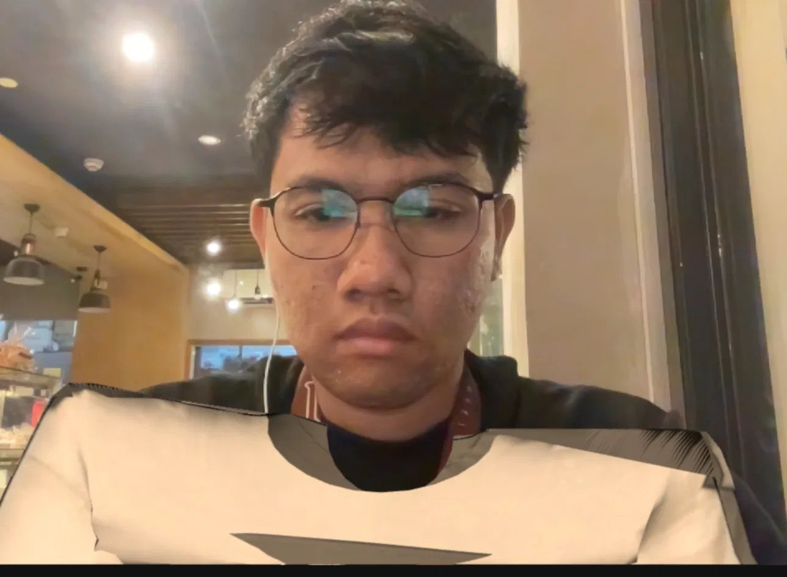
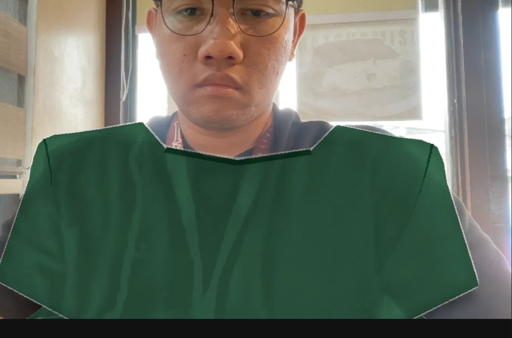

# Virtual T-Shirt Fitting Room

> **Status: work in progress.** Body tracking and the live T-shirt overlay work. I am now improving realism: fit, lighting, and how the shirt moves with the body.

## Progress

| Early overlay (2D) | Current: skinned mesh with scene lighting |
|---|---|
|  |  |

## Tech Stack

| Part | Technology |
|---|---|
| Frontend | React 19, TypeScript, Vite, Three.js |
| Body tracking | MediaPipe Tasks Vision (pose landmarks and person segmentation, in the browser) |
| Backend | Python, FastAPI, SQLAlchemy (SQLite) |
| Garment processing | OpenCV, rembg (background removal), NumPy, SciPy |
| Testing | Vitest, Testing Library, Playwright, pytest |

A locally running virtual fitting room for a clothing store, with two dashboards sharing one backend:

- **Customer kiosk** (`/`) — live camera, body tracking, a virtual T-shirt drawn over the customer, size switching, and a size estimate with an explicit confidence level.
- **Owner dashboard** (`/owner`) — sign-in, products, sizes and measurements, colors, stock, camera or upload capture of garment photos, automatic background removal, anchor editing, draft and publish, camera calibration, and settings.

Customer camera frames never leave the browser. Pose tracking and person segmentation run in the browser through MediaPipe, from model files served locally. Body estimates are sent to the local backend only to compute a recommendation. They are never stored.

## Quick start

```bash
# backend (Python 3.11)
cd backend
/opt/homebrew/bin/python3.11 -m venv .venv
.venv/bin/pip install -r requirements.txt
.venv/bin/python -m app.cli create-owner owner          # prompts for a password
.venv/bin/python -m app.cli seed-samples                # optional, clearly labelled SAMPLE products
.venv/bin/uvicorn app.main:app --host 127.0.0.1 --port 8000

# frontend (new terminal)
cd frontend
npm install
npm run fetch-models                                    # MediaPipe WASM + pose/segmentation models into public/
npm run dev                                             # http://127.0.0.1:5173
```

- Kiosk: http://127.0.0.1:5173/
- Owner: http://127.0.0.1:5173/owner

Full setup, troubleshooting and first-run notes: [docs/SETUP.md](docs/SETUP.md).

## Shirts folder

Put shirt photos (`.png`, `.jpg`, `.jpeg`, `.webp`) in `./Tshirts`. The kiosk lists every image there; the folder is rescanned on backend startup and on every kiosk load, so a new file shows up without code changes.

- **Label:** taken from the filename. Underscores and dashes become spaces, then title case: `good_things-tee.jpg` → "Good Things Tee".
- **Processing:** each image is processed once, locally: background removal, cropping, anchors, and detection of color, neckline, sleeve length and print.
- **Cache:** results are stored in `./Tshirts/.cache/` (JSON plus PNGs), keyed by file contents. A renamed file reuses its cache; an edited file is re-processed.
- **Front and back:** an image showing the front above the back (one shirt over the other) is split; the back is used when the customer turns.
- **Your files:** originals are only read, never modified, moved or deleted.
- **Sizing:** folder shirts have no size chart, so they are fitted to the wearer's body. Store products with real measurements, added via the owner dashboard, still get size estimates.

## Documentation

| Doc | Contents |
|---|---|
| [docs/SETUP.md](docs/SETUP.md) | Install, run, first owner, camera setup, troubleshooting |
| [docs/ARCHITECTURE.md](docs/ARCHITECTURE.md) | Components, data model, API, fitting and fit-estimate rules, privacy, known limitations |
| [docs/PRODUCT_UPLOAD.md](docs/PRODUCT_UPLOAD.md) | Adding and publishing a T-shirt, photographing, the measurement guide |
| [docs/CALIBRATION.md](docs/CALIBRATION.md) | ArUco calibration and what it can and cannot measure |
| [docs/TESTING.md](docs/TESTING.md) | Automated tests, manual hardware tests, and their results |
| [DEVELOPMENT_CHECKLIST.md](DEVELOPMENT_CHECKLIST.md) | Requirement-by-requirement status |

## What this is not

- **Not photorealistic.** The shirt is a procedural 3D mesh wrapped around the tracked body, textured from the product photo and lit to match the room. It has no cloth physics.
- **Not a body scanner.** One RGB camera cannot measure chest circumference. Size suggestions are labelled estimates, and the kiosk says so when it can't make one.
- No checkout, payments or analytics in this MVP.
